# AcquaXcontrol — Fluxograma e Mapa Completo do Sistema

> Documento gerado a partir do código-fonte em 06/11/2026.
> Cobre arquitetura, perfis, todas as telas, todos os fluxos, todas as rotas de API,
> entidades, serviços, integrações, automações e regras de negócio.
>
> Números do sistema nesta data: **54 páginas**, **135 rotas de API**, **36 entidades**,
> **7 automações agendadas (crons)**, **24 serviços de domínio + 6 módulos do assistente**.

---

## 1. Visão geral

O AcquaXcontrol é a plataforma de gestão de medição de água (e gás/energia) da AcquaX do
Brasil. Ela recebe leituras de medidores (manuais, por planilha ou IoT), registra a conta
da concessionária, apura o consumo por unidade, calcula o rateio, gera extratos
(filipetas/levantamento) e comunica moradores e síndicos por e-mail e pelo painel.

| Camada | Tecnologia |
|---|---|
| Front-end / SSR | Next.js 15 (App Router), React, Tailwind, Shadcn UI, PWA com service worker |
| API | Route Handlers em `app/api/**` (Node runtime), autenticação por cookie de sessão JWT e API Key na v1 |
| Persistência | MongoDB (DigitalOcean) com Prisma 6 e middleware global de soft delete |
| Arquivos/fotos | Backblaze B2 via API S3, servido pelo CDN `cdn.acquaxcontrol.com.br` (Cloudflare) |
| E-mail | Zoho SMTP (`sistema@acquaxdobrasil.com.br`) com fila `EmailJob` drenada por cron |
| IoT | Integração GroupLink: arquivos em S3 (`events/`, `alarms/`) e API de dispositivos |
| IA | Mariana (assistente), Google Gemini |
| Hospedagem | Vercel (produção `www.acquaxcontrol.com.br`) |

### 1.1 Arquitetura macro

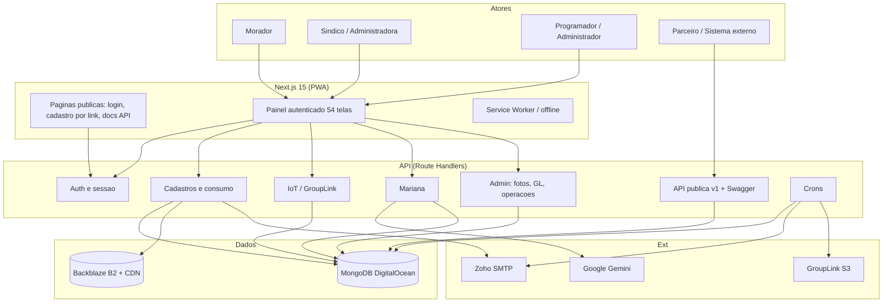

---

## 2. Perfis de acesso e RBAC

O acesso não é definido por um campo no usuário: é definido por **vínculos (RoleAssignment)**
que ligam um usuário a um papel dentro de um contexto (sistema, empresa, condomínio, bloco
ou unidade). As permissões efetivas vêm do papel (`Role` → `Permission` com `entity` + `action`).

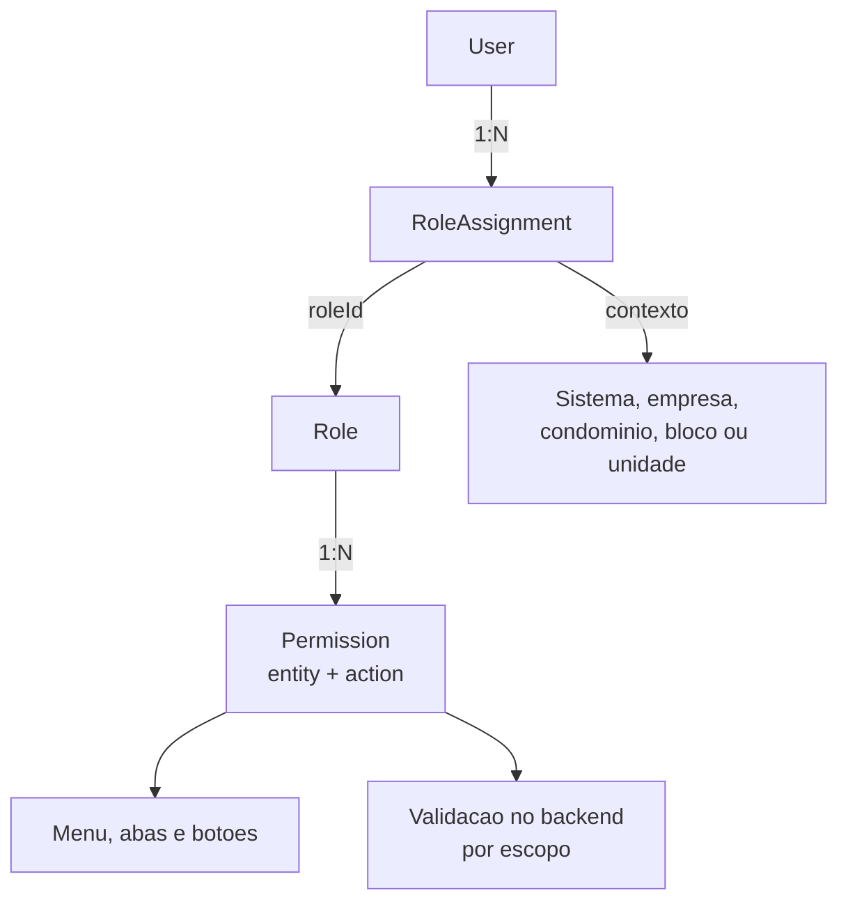

| Perfil | Como é identificado | Alcance típico |
|---|---|---|
| Morador | vínculo `apartment` | Própria unidade: consumo, filipeta, chamados |
| Síndico | vínculo `complex` ou `block` | Condomínio inteiro: leituras, contas, relatórios |
| Administradora | vínculo `company` | Carteira de condomínios |
| Programador | vínculo `system` | Operação e cadastros, sem excluir administrador |
| Administrador | vínculo `system` | Acesso total, incluindo exclusões sensíveis |

Regras relevantes:

- Menus e abas são filtrados por `lib/role-tab-config.ts` + `components/sidebar-permission-map.ts`.
- A API sempre revalida o escopo no servidor (`lib/userData.ts`, `lib/userContexts.ts`).
- O menu e a rota **Fotos de Medidor** (`/admin/fotos`) são restritos ao login `admin@acquax.com`
  (`PHOTO_ADMIN_EMAILS`), independentemente do papel.
- Programador não pode excluir nem alterar contas de Administrador.

---

## 3. Mapa de telas (54 páginas)

### 3.1 Público e autenticação

| Rota | Função |
|---|---|
| `/` | Redireciona para login ou dashboard |
| `/login` | Autenticação por e-mail e senha |
| `/first-access` | Primeiro acesso com senha provisória (troca obrigatória) |
| `/recover` | Recuperação de senha por e-mail |
| `/reset-password` | Definição de nova senha |
| `/signup` | Auto-cadastro público (quando habilitado) |
| `/cadastro/[token]` | Cadastro de morador por link do condomínio |
| `/suspended` | Aviso de condomínio suspenso |
| `/docs/api` | Documentação pública da API (Swagger) |
| `/politica-de-privacidade`, `/offline`, `/blog/post-1` | Conteúdo e fallback PWA |

### 3.2 Painel operacional

| Rota | Função |
|---|---|
| `/dashboard` | Visão inicial por perfil (admin, síndico, morador, programador) |
| `/dashboard/preview` | Pré-visualização do dashboard por papel |
| `/readings`, `/readings/create`, `/readings/[id]` | Leituras: lista, lançamento e edição |
| `/dealership-readings`, `/new`, `/[id]`, `/[id]/edit`, `/[id]/filipeta` | Contas da concessionária: cadastro, edição e filipeta |
| `/apartment-report`, `/[id]`, `/[id]/edit` | Relatórios de consumo por unidade |
| `/levantamento` | Levantamento comparativo por unidade e mês (impressão) |
| `/meter-report` | Extrato/filipeta por unidade (impressão e PDF) |
| `/consumption-dashboard` | Dashboards de consumo, área comum e comparativos |
| `/monitoring`, `/alerts` | Monitoramento IoT e alarmes |
| `/reservoirs`, `/reservoir-monitoring`, `/[id]` | Reservatórios e medidores de nível |
| `/apuracao` | Painel de apuração por condomínio (cobertura, última leitura) |

### 3.3 Cadastros e administração

| Rota | Função |
|---|---|
| `/companies` | Administradoras |
| `/complexes` | Condomínios (inclusive suspensão) |
| `/blocks`, `/apartments`, `/meters` | Blocos, unidades e medidores |
| `/devices` | Dispositivos IoT e vínculo com medidores |
| `/users`, `/roles`, `/role-customization` | Usuários, papéis, permissões e personalização de abas |
| `/links-cadastro` | Links públicos de cadastro por condomínio |
| `/gl-integration` | Integração GroupLink (status, importação retroativa) |
| `/api-manager` | Chaves de API, permissões, escopos, logs de uso e docs |
| `/admin/fotos` | Ferramenta de fotos de medidor (restrita ao admin) |
| `/api-docs` | Swagger da API v1 dentro do painel |

### 3.4 Comunicação e suporte

| Rota | Função |
|---|---|
| `/comunicado` | Comunicados para públicos segmentados |
| `/suporte` | Chamados (síndico/morador) e atendimento |
| `/sugestoes` | Sugestões e votos |
| `/guia` | Guia de uso da plataforma |
| `/account`, `/solutions` | Conta do usuário e página de soluções |

---

## 4. Fluxos detalhados

### 4.1 Autenticação e sessão

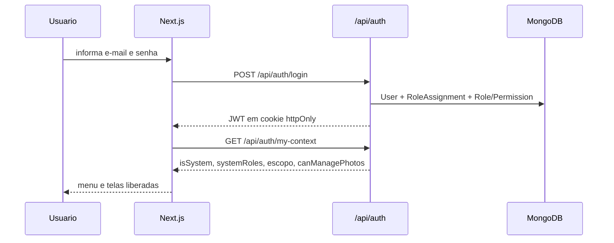

- Senha provisória força troca no primeiro acesso (`/first-access`).
- Recuperação gera token por e-mail e leva a `/reset-password`.
- Sessão inválida no banco ainda é aceita se o JWT estiver válido (renovação transparente).
- Condomínio suspenso bloqueia o contexto (`/suspended`).
- `router`/middleware protegem o painel; `/docs`, `/swagger` e arquivos públicos passam direto.

### 4.2 Cadastro por link do condomínio

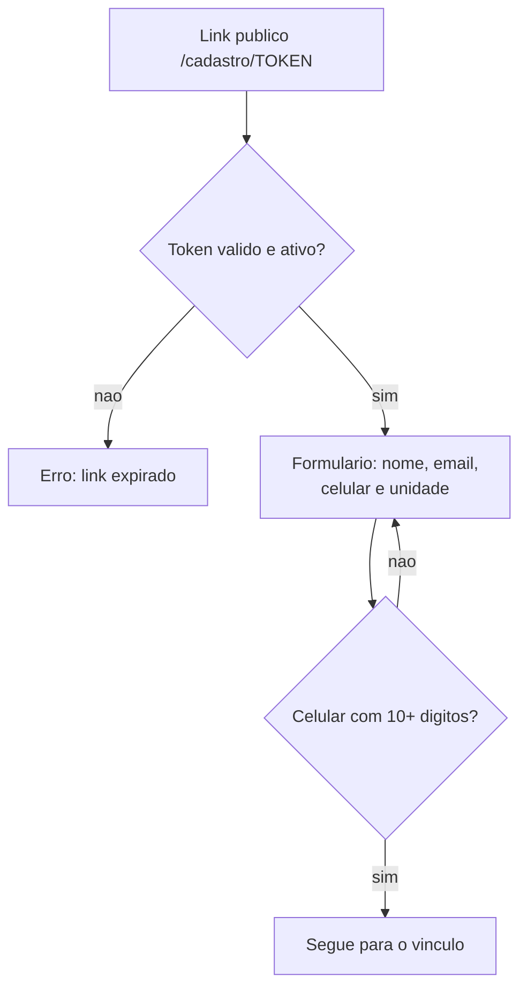

**4.2.b Criacao do usuario e vinculo**

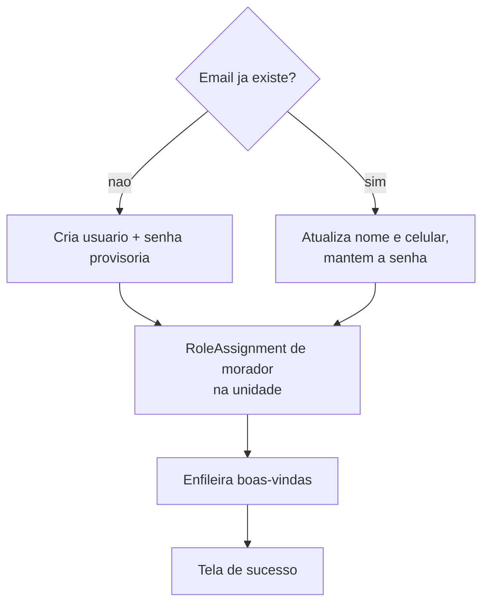

- `RegistrationInvite` guarda o token por condomínio; `RegistrationClaim` registra o uso.
- Reaproveitar usuário evita duplicidade e preserva a senha atual (orientação: "Esqueci minha senha").

### 4.3 Cadastro operacional

Ordem natural: **Administradora → Condomínio → Bloco → Unidade → Medidor → Dispositivo**.

- Medidor guarda a referência (`register`), que é a chave usada nas planilhas e no app de campo.
- `MeterDeviceLink` liga medidor a `IotDevice` (vínculo pode ser criado por importação de planilha).
- Unidade sem bloco é permitida (relação opcional) para bases legadas.

### 4.4 Entrada de leituras

```mermaid
flowchart LR
  subgraph Origens
    M[Digitacao manual /readings/create]
    P[Planilha /api/import-medicao]
    D[Planilha diaria /readings/import-daily]
    I[IoT GroupLink events/ arquivo S3]
    A[API v1 POST /readings]
  end
  M --> V[Validacao: medidor, data, duplicidade por mes/ano]
  P --> V
  D --> V
  I --> V
  A --> V
  V --> RD[(Reading)]
  RD --> UN{Medidor vinculado?}
  UN -- nao --> SAI[Leitura unlinked: /readings/unlinked]
  SAI --> VINC[Vincular device a medidor]
  VINC --> REP[Reprocessar leituras]
  UN -- sim --> OK[Disponivel para apuracao]```

- Duplicidade: uma leitura por medidor por mês/ano (a API v1 recusa e devolve o ID existente).
- Leituras órfãs entram em fila de vinculação (`unlinked`) com reprocessamento em lote.
- Importações pesadas usam lotes (evita timeout de transação e OOM no MongoDB).

### 4.5 Conta da concessionária e apuração

```mermaid
flowchart TD
  C[Conta do mes: agua, esgoto, area comum, total, tarifa] --> VAL{Tarifa preenchida?}
  VAL -- nao --> BLOQ[Bloqueado: tarifa obrigatoria]
  VAL -- sim --> DR[(DealershipReading)]
  DR --> MOD[Modelo de calculo do condominio]
  MOD --> CALC{Apuracao}
  CALC --> IMP[Importacao combinada de planilha]
  CALC --> GEN[Geracao de relatorios por unidade]
  CALC --> UNI[Edicao unificada de um relatorio]
  IMP --> ACR[(ApartmentConsumptionReport)]
  GEN --> ACR
  UNI --> ACR
  ACR --> LEV[/levantamento e /meter-report/]
  ACR --> FLP[Filipeta PDF e e-mail]
  ACR --> DASH[Dashboards de consumo]
```

Regras conhecidas:

- A conta define água, esgoto, área comum (`diffCost`), carro-pipa e total.
- O relatório por unidade guarda `consumptionCost` (água), `sewageCost` (esgoto),
  `partial` (rateio de área comum), `kiteCarCost` e `totalUnit`.
- `totalUnit` deve ser igual à soma das parcelas. Quando a planilha traz o total com rateio
  mas deixa a coluna de rateio vazia, a diferença fica escondida dentro de água/esgoto e o
  Levantamento (que mostra Água/Esgoto = total − área comum) exibe o total na linha errada.
- A edição de um relatório reativa automaticamente leitura removida em reprocessamento
  (soft deleted) e grava `monthRef`/`yearRef` do relatório.

### 4.6 Motor de cálculo e rateio

| Item | Como funciona |
|---|---|
| Tarifas | Faixas progressivas por m³ (`MANUAL_MONTHLY`, `CALCULATED` ou `FIXED`) |
| Esgoto | Percentual sobre o valor da água (varia por modelo) |
| Área comum | `NONE`, `EQUAL` (igualitário), `FRACTION` (fração ideal), `PROPORTIONAL`, `INVERSE_PROPORTIONAL` |
| Carro-pipa | Consumo e custo rateados conforme o modelo |
| Extras | Taxas administrativas, fundos e encargos por modelo |
| Origem | Modelos reutilizáveis vinculados a um ou vários condomínios |

### 4.7 Filipeta, levantamento e relatórios

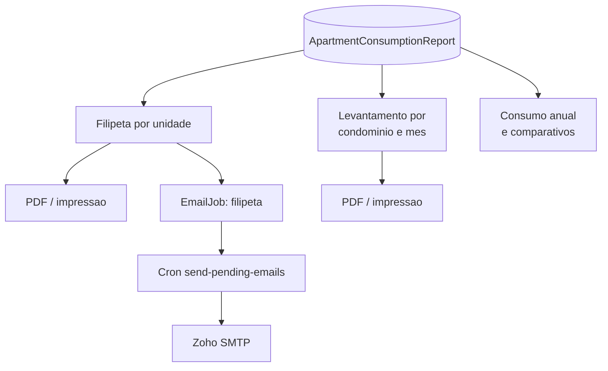

- Geração oficial pelas abas `/meter-report` (filipeta) e `/levantamento` (planilha comparativa).
- Envios em massa passam pela fila; reset de senha e boas-vindas individuais são imediatos.

### 4.8 Comunicação por e-mail

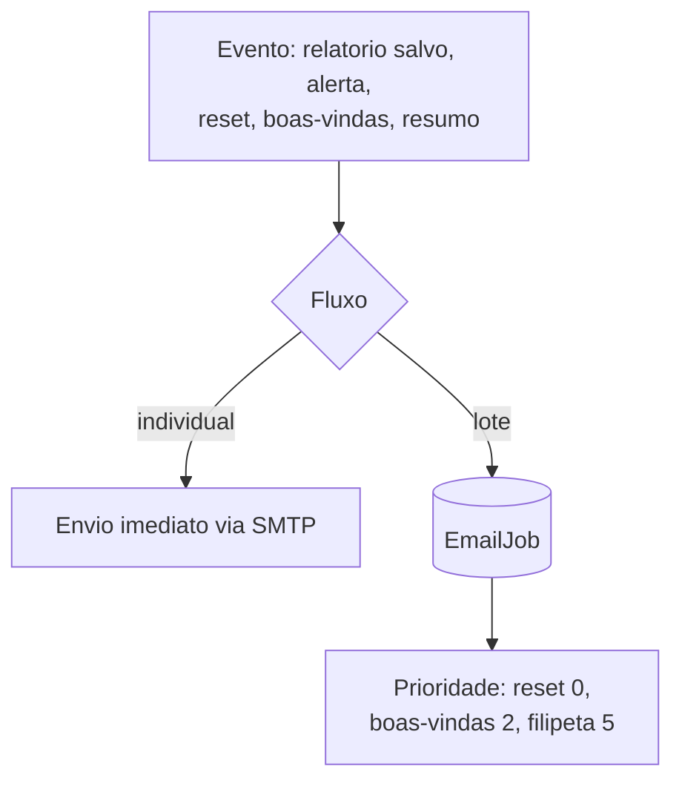

**4.8.b Processamento da fila**

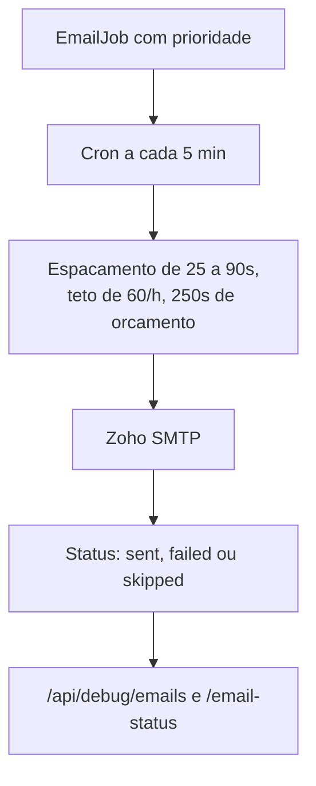

- Domínios internos (`@acquax*`) são marcados como `skipped` (economia de cota).
- Bloqueio antispam do Zoho: a fila pausa e devolve a tentativa, não queima o job.
- Categorias permitem ver, na saúde do e-mail, o que é fila e o que foi imediato.

### 4.9 Automações agendadas (crons)

| Cron | Frequência | O que faz |
|---|---|---|
| `/api/cron/gl-import` | 10h e 22h | Importa leituras do GroupLink (S3) |
| `/api/cron/send-pending-emails` | a cada 5 min | Drena a fila `EmailJob` com ritmo humano |
| `/api/cron/check-consumption-goals` | diário 8h | Verifica metas de consumo por unidade |
| `/api/cron/leak-detection` | segunda 8h | Detecta vazamento por consumo atípico |
| `/api/cron/send-alert-summary` | segunda 9h | Resumo de alertas para síndicos |
| `/api/cron/send-monthly-summary` | dia 5, 10h | Resumo mensal do condomínio |
| `/api/cron/cleanup-soft-deleted` | dia 1, 3h | Inventário de registros removidos (não destrutivo) |

### 4.10 Fotos de medidor

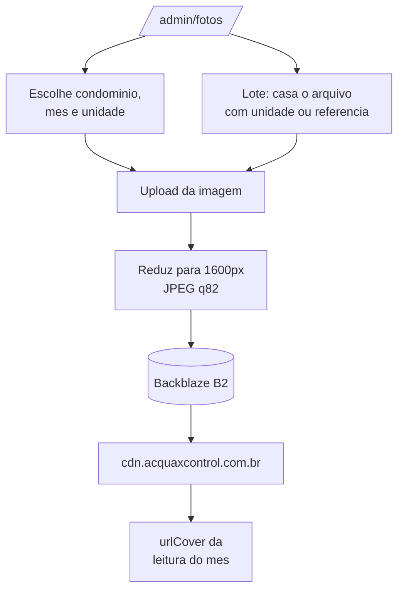

- Se a leitura já tem link do CDN, o arquivo é sobrescrito na mesma chave (o link não muda).
- Sem link anterior, o caminho é `<CONDOMINIO>/<ANO>/<MM - Mes>/Fotos/<unidade>.jpg`.
- Leitura removida em reprocessamento recebe o link sem ser reativada.
- Acesso restrito a `admin@acquax.com` (menu oculto para os demais).

### 4.11 API pública v1

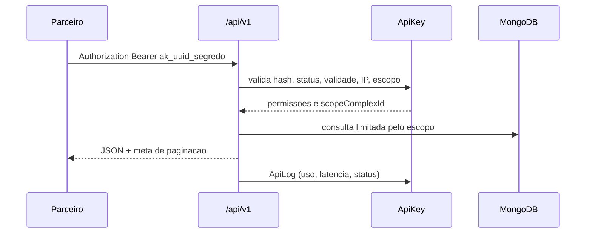

| Recurso | Endpoints |
|---|---|
| Status | `GET /api/v1` |
| Cadastros | `GET /complexes`, `/apartments`, `/meters` |
| Leituras | `GET /readings`, `POST /readings` (ate 200 por lote) |
| Relatórios | `GET /reports` (mês e ano obrigatórios) |
| Usuários | `GET /users`, `POST /users/{id}/reset` |

- Documentação: `/docs/api` (pública, Swagger), `/api-docs` (painel) e `/api/openapi.yaml`.
- Guia em PDF para parceiros: `docs/API-PARCEIROS.pdf`.

### 4.12 Mariana (assistente de IA)

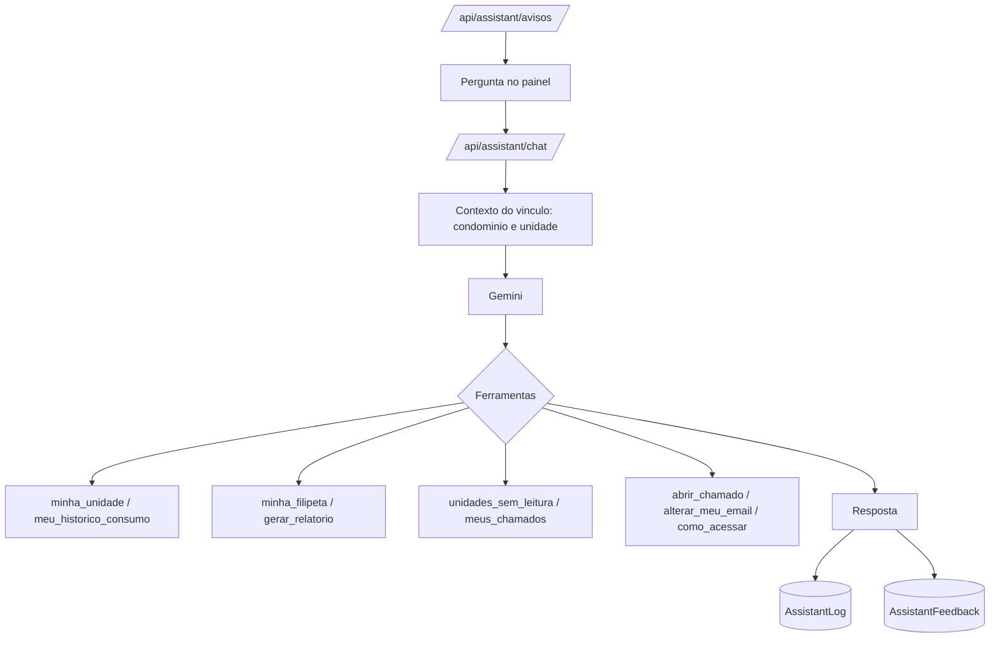

- Sempre no escopo do usuário; nunca mostra dado de outra unidade.
- Histórico e análises usam 3 meses por padrão.
- Pergunta o bloco quando a unidade existe em mais de um bloco.
- Filipeta e levantamento são gerados pelas abas oficiais da plataforma.

### 4.13 Suporte, sugestões e comunicados

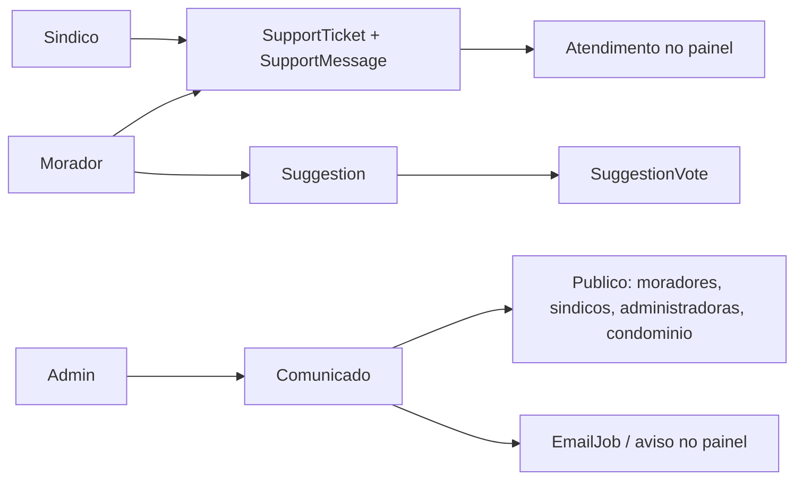

---

### 4.14 Reservatórios e medidores de nível

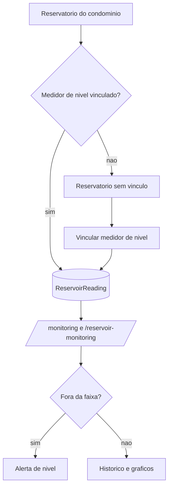

- Cadastro em `/reservoirs`, vínculo em `/reservoirs/{id}/link`, leituras por `/api/reservoir-readings`.
- Reservatórios sem vínculo aparecem em `/reservoirs/unlinked`.

### 4.15 Alertas, vazamento e metas de consumo

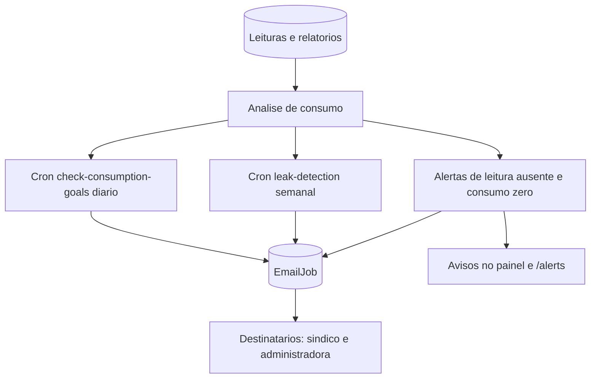

- `notification-recipients` resolve quem recebe por condomínio e papel.
- Resumo semanal de alertas (segunda, 9h) e resumo mensal (dia 5, 10h) usam a mesma fila.

### 4.16 Importação de usuários em lote

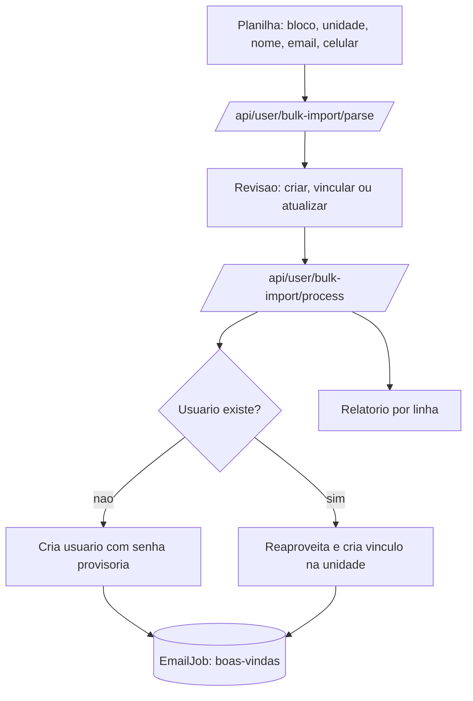

- Redefinição em massa (`/api/user/users/bulk-reset`) segue o mesmo padrão de relatório por linha.
- Exportações de usuários, unidades, blocos, condomínios e medidores usam `.xlsx`.

### 4.17 Webhooks de saída

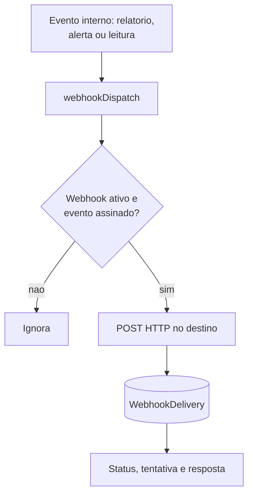

- Cadastro e teste em `/api/user/webhooks`; histórico em `WebhookDelivery`.

### 4.18 Suspensão de condomínio

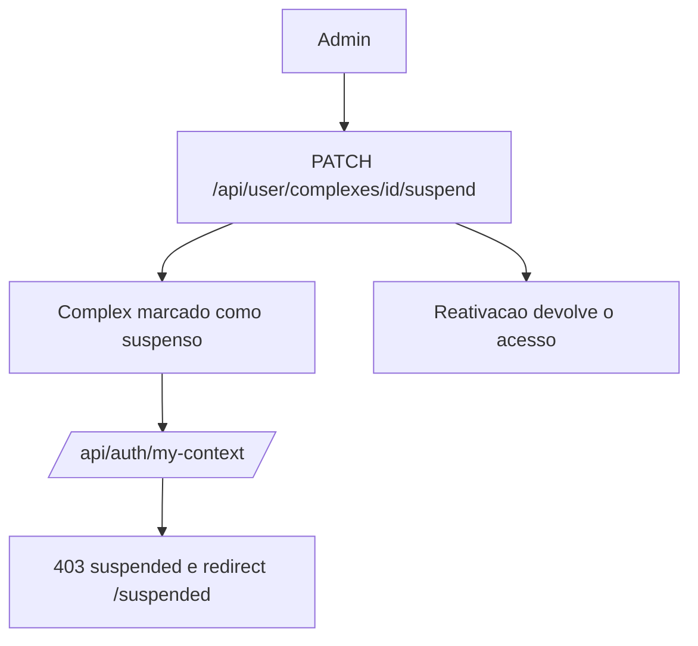

### 4.19 Soft delete, limpeza e retenção

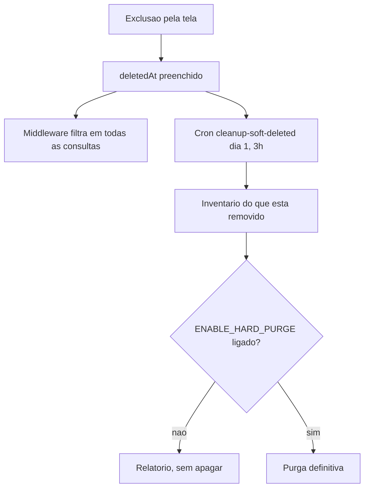

- Nada é apagado fisicamente por padrão.
- Vínculos em cascata são tratados caso a caso (usuário, unidade, medidor).

### 4.20 PWA, offline e atualização de versão

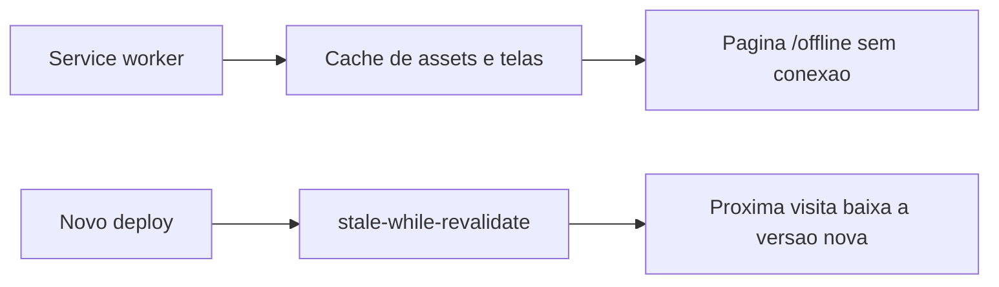

### 4.21 Processos transversais

| Processo | Onde acontece |
|---|---|
| Impressão e PDF | `/levantamento`, `/meter-report`, `/dealership-readings/{id}/filipeta` |
| Exportação `.xlsx` | Usuários, condomínios, blocos, unidades, medidores, relatórios |
| Auditoria de uso da API | `ApiLog` (chave, rota, latência, status, IP) |
| Auditoria do assistente | `AssistantLog` e `AssistantFeedback` |
| Comunicados | `Comunicado` + público-alvo (`comunicado-audience`) + fila de e-mail |
| Saúde do sistema | `/api/health`, `/api/debug`, `/api/debug/emails`, `/api/gl-status` |
| Personalização de abas | `/role-customization` + `lib/role-tab-config.ts` |
| Sessão e preferências | `/api/auth/me`, `/api/auth/me/preferences` |
| Agendamentos (schema) | `ScheduledTask`, `RecurringSchedule`, `ScheduleOverride` existem no banco, sem uso no código atual |

## 5. Entidades (36 modelos)

```mermaid
erDiagram
  Company ||--o{ Complex : possui
  Complex ||--o{ Block : divide
  Block ||--o{ Apartment : contem
  Complex ||--o{ Apartment : agrega
  Apartment ||--o{ Meter : mede
  Meter ||--o{ Reading : registra
  Meter ||--o{ MeterDeviceLink : vincula
  IotDevice ||--o{ MeterDeviceLink : conecta
  Complex ||--o{ DealershipReading : conta
  DealershipReading ||--o{ ApartmentConsumptionReport : apura
  Apartment ||--o{ ApartmentConsumptionReport : recebe
  Complex ||--o{ Reservoir : tem
  Reservoir ||--o{ ReservoirReading : mede
  User ||--o{ RoleAssignment : assume
  Role ||--o{ RoleAssignment : define
  Role ||--o{ Permission : permite
  User ||--o{ ApiKey : emite
  ApiKey ||--o{ ApiLog : registra
  User ||--o{ SupportTicket : abre
  SupportTicket ||--o{ SupportMessage : contem
  User ||--o{ Suggestion : envia
  Suggestion ||--o{ SuggestionVote : vota
  Complex ||--o{ RegistrationInvite : gera
  RegistrationInvite ||--o{ RegistrationClaim : usa
  Webhook ||--o{ WebhookDelivery : entrega
```

| Grupo | Entidades |
|---|---|
| Pessoas e acesso | `User`, `Session`, `Role`, `Permission`, `RoleAssignment` |
| Locais | `Company`, `Complex`, `Block`, `Apartment` |
| Medição | `TypeMeter`, `Meter`, `IotDevice`, `MeterDeviceLink`, `Reading` |
| Faturamento | `Dealership`, `DealershipReading`, `ApartmentConsumptionReport` |
| Reservatórios | `Reservoir`, `ReservoirReading` |
| Agenda | `ScheduledTask`, `RecurringSchedule`, `ScheduleOverride` |
| Atendimento | `SupportTicket`, `SupportMessage`, `Suggestion`, `SuggestionVote` |
| Integrações | `ApiKey`, `ApiLog`, `Webhook`, `WebhookDelivery`, `GlImportLog`, `GlAlarm` |
| Comunicação | `EmailJob`, `Comunicado` |
| Cadastro público | `RegistrationInvite`, `RegistrationClaim` |

---

## 6. Todas as rotas de API (135)

Inventário completo gerado do código: **135 rotas** em 11 domínios.

### 6.1 Autenticação e sessão

| Métodos | Rota |
|---|---|
| POST | `/api/auth/login` |
| POST | `/api/auth/logout` |
| GET, PUT | `/api/auth/me` |
| GET, PUT | `/api/auth/me/preferences` |
| GET | `/api/auth/my-context` |
| POST | `/api/auth/recover` |
| POST | `/api/auth/reset-password` |
| POST | `/api/auth/session` |
| POST | `/api/auth/signup` |

### 6.2 Consumo: leituras, contas e relatórios

| Métodos | Rota |
|---|---|
| GET | `/api/dealership-readings/[id]/filipeta` |
| GET | `/api/meter-report` |
| POST | `/api/monitoring/readings` |
| GET, POST | `/api/user/apartment-report` |
| DELETE, PUT | `/api/user/apartment-report/[entityId]` |
| POST | `/api/user/apartment-report/calculate` |
| POST | `/api/user/apartment-report/generate` |
| POST | `/api/user/apartment-report/unified` |
| POST | `/api/user/combined-import` |
| GET, POST | `/api/user/dealership-reading` |
| DELETE, PUT | `/api/user/dealership-reading/[entityId]` |
| POST | `/api/user/import-medicao` |
| GET, POST | `/api/user/readings` |
| PUT | `/api/user/readings/[id]` |
| POST | `/api/user/readings/import-daily` |
| POST | `/api/user/readings/import-iot` |
| GET | `/api/user/readings/unlinked` |
| GET, POST | `/api/v1/readings` |
| GET | `/api/v1/reports` |

### 6.3 IoT, dispositivos e monitoramento

| Métodos | Rota |
|---|---|
| GET | `/api/admin/gl/alarms` |
| GET | `/api/admin/gl/diagnostics` |
| GET, POST | `/api/admin/gl/retroactive-import` |
| GET, POST | `/api/admin/gl/set-meter-ids` |
| POST | `/api/admin/gl/temp-retro-import` |
| POST | `/api/admin/gl/update-meter-glids` |
| GET | `/api/cron/gl-import` |
| GET | `/api/gl-status` |
| POST | `/api/monitoring/alerts` |
| GET, POST | `/api/reservoir-readings` |
| GET, POST | `/api/reservoirs` |
| DELETE, GET, PUT | `/api/reservoirs/[id]` |
| DELETE, POST | `/api/reservoirs/[id]/link` |
| GET | `/api/reservoirs/unlinked` |
| GET, POST | `/api/user/devices` |
| DELETE, PUT | `/api/user/devices/[id]` |
| GET | `/api/user/devices/[id]/meter-links` |
| POST | `/api/user/devices/[id]/reprocess-readings` |
| GET | `/api/user/devices/[id]/unlinked-readings` |
| GET | `/api/user/devices/devices-list` |
| POST | `/api/user/devices/import-links/process` |
| POST | `/api/user/devices/import-links/validate` |
| POST | `/api/user/devices/meter-links` |
| DELETE, PUT | `/api/user/devices/meter-links/[linkId]` |
| GET | `/api/user/devices/unlinked-readings` |
| GET | `/api/user/devices/with-unlinked-readings` |

### 6.4 Cadastros

| Métodos | Rota |
|---|---|
| GET, POST | `/api/user/apartments` |
| DELETE, PUT | `/api/user/apartments/[entityId]` |
| POST | `/api/user/apartments/export` |
| GET, POST | `/api/user/blocks` |
| DELETE, PUT | `/api/user/blocks/[blockId]` |
| POST | `/api/user/blocks/export` |
| GET, POST | `/api/user/companies` |
| DELETE, PUT | `/api/user/companies/[entityId]` |
| GET, POST | `/api/user/complexes` |
| DELETE, PUT | `/api/user/complexes/[entityId]` |
| PATCH | `/api/user/complexes/[entityId]/suspend` |
| POST | `/api/user/complexes/export` |
| GET, POST | `/api/user/dealerships` |
| GET, POST | `/api/user/meters` |
| DELETE, PUT | `/api/user/meters/[entityId]` |
| POST | `/api/user/meters/export` |
| GET, POST | `/api/user/type-meters` |

### 6.5 Usuários, papéis e permissões

| Métodos | Rota |
|---|---|
| GET, POST | `/api/public/register/[token]` |
| GET | `/api/user-permissions` |
| POST | `/api/user/bulk-import/parse` |
| POST | `/api/user/bulk-import/process` |
| GET, POST | `/api/user/permissions` |
| DELETE, PUT | `/api/user/permissions/[entityId]` |
| GET, POST | `/api/user/registration-invites` |
| PATCH | `/api/user/registration-invites/[id]` |
| GET, POST | `/api/user/role-assignments` |
| DELETE | `/api/user/role-assignments/[entityId]` |
| GET, POST | `/api/user/roles` |
| DELETE, PUT | `/api/user/roles/[entityId]` |
| GET, POST | `/api/user/users` |
| DELETE, PUT | `/api/user/users/[entityId]` |
| POST | `/api/user/users/[entityId]/reset` |
| POST | `/api/user/users/bulk-reset` |
| POST | `/api/user/users/export` |
| GET | `/api/v1/users` |
| POST | `/api/v1/users/[id]/reset` |

### 6.6 Comunicação, suporte e conteúdo

| Métodos | Rota |
|---|---|
| GET | `/api/assistant/avisos` |
| GET, POST | `/api/assistant/chat` |
| POST | `/api/assistant/consumo` |
| POST | `/api/assistant/feedback` |
| GET | `/api/assistant/relatorio` |
| GET, POST | `/api/user/comunicados` |
| DELETE, GET | `/api/user/comunicados/[id]` |
| GET, POST | `/api/user/suggestions` |
| DELETE, PATCH | `/api/user/suggestions/[suggestionId]` |
| POST | `/api/user/suggestions/[suggestionId]/vote` |
| GET, POST | `/api/user/support` |
| GET, PATCH | `/api/user/support/[ticketId]` |
| POST | `/api/user/support/[ticketId]/messages` |
| GET, POST | `/api/user/webhooks` |
| DELETE, GET, PATCH | `/api/user/webhooks/[webhookId]` |

### 6.7 E-mail e notificações

| Métodos | Rota |
|---|---|
| GET | `/api/debug/emails` |
| GET | `/api/user/email-status` |
| POST | `/api/user/trigger-emails` |

### 6.8 API pública, documentação e administração

| Métodos | Rota |
|---|---|
| GET | `/api` |
| GET | `/api/admin-stats` |
| GET | `/api/admin/operations/summary` |
| GET, POST | `/api/admin/photos` |
| GET | `/api/apuracao` |
| GET | `/api/openapi.yaml` |
| GET, POST | `/api/user/api-keys` |
| DELETE, GET, PATCH | `/api/user/api-keys/[keyId]` |
| GET | `/api/user/api-keys/logs` |
| GET | `/api/v1` |
| GET | `/api/v1/apartments` |
| GET | `/api/v1/complexes` |
| GET | `/api/v1/meters` |

### 6.9 Dashboard e diagnóstico

| Métodos | Rota |
|---|---|
| GET | `/api/block-comparison` |
| GET | `/api/dashboard/annual-consumption` |
| GET | `/api/dashboard/common-area` |
| GET | `/api/dashboard/consumption-analysis` |
| GET | `/api/debug` |
| GET | `/api/health` |

### 6.10 Crons

| Métodos | Rota |
|---|---|
| POST | `/api/cron/check-consumption-goals` |
| GET, POST | `/api/cron/cleanup-soft-deleted` |
| POST | `/api/cron/leak-detection` |
| POST | `/api/cron/send-alert-summary` |
| POST | `/api/cron/send-monthly-summary` |
| GET | `/api/cron/send-pending-emails` |

### 6.11 Outros

| Métodos | Rota |
|---|---|
| GET | `/api/user/send-test-email` |
| GET | `/api/user/send-welcome-email` |

---

## 7. Serviços de domínio (26)

| Serviço | Responsabilidade |
|---|---|
| `calculation-model-parser` | Lê planilha modelo e extrai faixas, esgoto, área comum |
| `combined-import-service` | Importação combinada de medição + faturamento |
| `medicao-parser` | Normaliza colunas da planilha de medição |
| `iot-reading-service` | Converte eventos do GroupLink em leituras |
| `gl-import-service` / `gl-alarm-import-service` | Importação de leituras e alarmes do S3 |
| `device-management-service` | Dispositivos, vínculos e reprocessamento |
| `reading-link-service` | Liga leitura órfã ao medidor correto |
| `reading-fast-reprocess-service` | Reprocessa leituras em lote |
| `consumption-analysis` | Comparativos e séries de consumo |
| `latest-report-by-complex` | Último relatório por condomínio (consultas rápidas) |
| `email-service` / `email-queue` | SMTP e fila `EmailJob` |
| `email-queue-trigger` | Dispara a fila após eventos |
| `filipeta-email-dispatcher` / `filipeta-email-template` | Monta e envia filipetas |
| `welcome-email-template` / `transactional-email-templates` | Templates de boas-vindas e transacionais |
| `management-insights-email` | Insights gerenciais para síndicos |
| `notification-recipients` | Resolve destinatários por público |
| `leak-detection-service` | Detecção de vazamento |
| `suspension-service` | Suspensão de condomínio e bloqueio de acesso |
| `photo-storage` | Upload para B2 e montagem de URL do CDN |
| `assistant/*` | Mariana: prompt, ferramentas, Gemini, auditoria, avisos |

---

## 8. Integrações e variáveis de ambiente

| Integração | Variáveis principais | Uso |
|---|---|---|
| Banco | `DATABASE_URL` | MongoDB de produção |
| Sessão | `JWT_SECRET` | Assinatura do cookie de sessão |
| Zoho SMTP | `ZOHO_SMTP_HOST`, `ZOHO_SMTP_PORT`, `ZOHO_SMTP_USER`, `ZOHO_SMTP_PASS`, `ZOHO_SMTP_FROM_NAME` | Envio de e-mails |
| GroupLink S3 | `GL_S3_REGION`, `GL_S3_ACCESS_KEY_ID`, `GL_S3_SECRET_ACCESS_KEY`, `GL_S3_BUCKET`, `GL_S3_PATH_PREFIX` | Leituras e alarmes IoT |
| Fotos (B2) | `B2_KEY_ID`, `B2_APP_KEY`, `B2_BUCKET`, `B2_ENDPOINT`, `B2_REGION` | Upload das fotos de medidor |
| Fotos (acesso) | `PHOTO_ADMIN_EMAILS` | Quem vê e usa `/admin/fotos` |
| IA | `GEMINI_API_KEY` (ou `GOOGLE_API_KEY`), `GEMINI_MODEL` | Mariana |
| Fila de e-mail | `EMAIL_GAP_MIN_MS`, `EMAIL_GAP_MAX_MS`, `EMAIL_RUN_BUDGET_MS`, `EMAIL_HOURLY_LIMIT` | Ritmo de envio |
| Manutenção | `ENABLE_HARD_PURGE` | Purga definitiva de soft deleted |

---

## 9. Regras e invariantes do sistema

1. **Soft delete global**: o middleware de `lib/prisma.ts` injeta `deletedAt` nas consultas;
   modelos sem o campo precisam estar em `MODELS_WITHOUT_DELETED_AT`.
2. **Consultas por e-mail/nome**: usar `findFirst` com `deletedAt: null`, nunca `findUnique`
   em campo que participa de índice único composto.
3. **Filtros de texto**: usar `contains` em vez de `startsWith` (caracteres como `[` quebram no MongoDB).
4. **Tarifa obrigatória** no cadastro da conta/concessionária.
5. **Uma leitura por medidor por mês/ano** (a segunda é recusada com o ID existente).
6. **Relações opcionais no schema** quando o dado legado pode não existir (bloco, medidor).
7. **Importações em lote** (evita timeout de transação e OOM).
8. **Rateio**: `totalUnit = consumptionCost + sewageCost + partial + kiteCarCost`.
9. **Paginação sem truncar**: listas de condomínios não cortam carteiras grandes.
10. **CSP restritiva**: scripts apenas do próprio domínio (Swagger e afins são servidos localmente).

### 9.1 Pontos de atenção conhecidos

| Tema | Situação |
|---|---|
| Área comum zerada em importações antigas | Capri 06 a 10/2026 com `partial = 0` e total contendo rateio (ex.: unidade 406 em 10/2026, R$ 43,90) |
| Leituras com `monthRef` por extenso | Registros antigos usam "Outubro"; filtros por período devem usar `from`/`to` |
| Relatórios apontando para leituras removidas | ~2.024 em 2026; a edição reativa automaticamente |
| Bloqueio antispam Zoho | Filas pausam e retomam sem queimar tentativas |
| Service worker | Pode servir versão anterior do front até atualizar o cache |
| Índices do MongoDB | Reavaliar `Readings` após período estável de uptime |

---

## 10. Observabilidade

| Recurso | O que mostra |
|---|---|
| `/api/health` | Saúde do app e do banco (200 ok, 503 degraded) |
| `/api/debug` | Informações de diagnóstico do ambiente |
| `/api/debug/emails` e `/api/user/email-status` | Fila de e-mail, categorias, falhas e próximos envios |
| `/api/gl-status` e `/admin/gl/diagnostics` | Conexão e arquivos do GroupLink |
| `/api/admin-stats` e `/api/admin/operations/summary` | Números operacionais do sistema |
| `ApiLog` | Uso, latência e status de cada chamada da API pública |
| `AssistantLog` / `AssistantFeedback` | Conversas da Mariana e avaliações |

---

## 11. Glossário rápido

- **Medidor (Meter)**: equipamento físico de uma unidade, identificado por `register`.
- **Leitura (Reading)**: valor lido em um medidor em uma data.
- **Conta (DealershipReading)**: fatura da concessionária do mês para o condomínio.
- **Relatório (ApartmentConsumptionReport)**: consumo e valores de uma unidade no mês.
- **Rateio / área comum**: parte da conta distribuída entre as unidades.
- **Filipeta**: extrato individual da unidade.
- **Levantamento**: planilha comparativa de várias unidades e meses.
- **GL (GroupLink)**: fornecedor de telemetria dos medidores.

---

## 12. Inventário de arquivos (rastreabilidade)

Gerado direto da árvore do projeto, para conferência item a item.

### 12.1 Todas as telas (54)

| Rota | Arquivo |
|---|---|
| `/` | `app/page.tsx` |
| `/account` | `app/(main)/account/page.tsx` |
| `/admin/fotos` | `app/(main)/admin/fotos/page.tsx` |
| `/alerts` | `app/(main)/alerts/page.tsx` |
| `/apartment-report` | `app/(main)/apartment-report/page.tsx` |
| `/apartment-report/[id]` | `app/(main)/apartment-report/[id]/page.tsx` |
| `/apartment-report/[id]/edit` | `app/(main)/apartment-report/[id]/edit/page.tsx` |
| `/apartments` | `app/(main)/apartments/page.tsx` |
| `/api-docs` | `app/(main)/api-docs/page.tsx` |
| `/api-manager` | `app/(main)/api-manager/page.tsx` |
| `/apuracao` | `app/(main)/apuracao/page.tsx` |
| `/blocks` | `app/(main)/blocks/page.tsx` |
| `/blog/post-1` | `app/(main)/blog/post-1/page.tsx` |
| `/cadastro/[token]` | `app/(auth)/cadastro/[token]/page.tsx` |
| `/companies` | `app/(main)/companies/page.tsx` |
| `/complexes` | `app/(main)/complexes/page.tsx` |
| `/comunicado` | `app/(main)/comunicado/page.tsx` |
| `/consumption-dashboard` | `app/(main)/consumption-dashboard/page.tsx` |
| `/dashboard` | `app/(main)/dashboard/page.tsx` |
| `/dashboard/preview` | `app/(main)/dashboard/preview/page.tsx` |
| `/dealership-readings` | `app/(main)/dealership-readings/page.tsx` |
| `/dealership-readings/[id]` | `app/(main)/dealership-readings/[id]/page.tsx` |
| `/dealership-readings/[id]/edit` | `app/(main)/dealership-readings/[id]/edit/page.tsx` |
| `/dealership-readings/[id]/filipeta` | `app/(main)/dealership-readings/[id]/filipeta/page.tsx` |
| `/dealership-readings/new` | `app/(main)/dealership-readings/new/page.tsx` |
| `/devices` | `app/(main)/devices/page.tsx` |
| `/docs/api` | `app/docs/api/page.tsx` |
| `/first-access` | `app/(auth)/first-access/page.tsx` |
| `/gl-integration` | `app/(main)/gl-integration/page.tsx` |
| `/guia` | `app/(main)/guia/page.tsx` |
| `/levantamento` | `app/(main)/levantamento/page.tsx` |
| `/links-cadastro` | `app/(main)/links-cadastro/page.tsx` |
| `/login` | `app/(auth)/login/page.tsx` |
| `/meter-report` | `app/(main)/meter-report/page.tsx` |
| `/meters` | `app/(main)/meters/page.tsx` |
| `/monitoring` | `app/(main)/monitoring/page.tsx` |
| `/offline` | `app/offline/page.tsx` |
| `/politica-de-privacidade` | `app/politica-de-privacidade/page.tsx` |
| `/readings` | `app/(main)/readings/page.tsx` |
| `/readings/[id]` | `app/(main)/readings/[id]/page.tsx` |
| `/readings/create` | `app/(main)/readings/create/page.tsx` |
| `/recover` | `app/(auth)/recover/page.tsx` |
| `/reservoir-monitoring` | `app/(main)/reservoir-monitoring/page.tsx` |
| `/reservoir-monitoring/[id]` | `app/(main)/reservoir-monitoring/[id]/page.tsx` |
| `/reservoirs` | `app/(main)/reservoirs/page.tsx` |
| `/reset-password` | `app/(auth)/reset-password/page.tsx` |
| `/role-customization` | `app/(main)/role-customization/page.tsx` |
| `/roles` | `app/(main)/roles/page.tsx` |
| `/signup` | `app/(auth)/signup/page.tsx` |
| `/solutions` | `app/(main)/solutions/page.tsx` |
| `/sugestoes` | `app/(main)/sugestoes/page.tsx` |
| `/suporte` | `app/(main)/suporte/page.tsx` |
| `/suspended` | `app/(auth)/suspended/page.tsx` |
| `/users` | `app/(main)/users/page.tsx` |

### 12.2 Serviços de domínio (24)

| Arquivo |
|---|
| `lib/services/combined-import-service.ts` |
| `lib/services/combined-import-test.ts` |
| `lib/services/consumption-analysis.ts` |
| `lib/services/device-management-service.ts` |
| `lib/services/email-queue.ts` |
| `lib/services/email-queue-trigger.ts` |
| `lib/services/email-service.ts` |
| `lib/services/filipeta-email-dispatcher.ts` |
| `lib/services/filipeta-email-template.ts` |
| `lib/services/gl-alarm-import-service.ts` |
| `lib/services/gl-import-service.ts` |
| `lib/services/iot-reading-service.ts` |
| `lib/services/latest-report-by-complex.ts` |
| `lib/services/leak-detection-service.ts` |
| `lib/services/link-import-service.ts` |
| `lib/services/management-insights-email.ts` |
| `lib/services/medicao-parser.ts` |
| `lib/services/notification-recipients.ts` |
| `lib/services/photo-storage.ts` |
| `lib/services/reading-fast-reprocess-service.ts` |
| `lib/services/reading-link-service.ts` |
| `lib/services/suspension-service.ts` |
| `lib/services/transactional-email-templates.ts` |
| `lib/services/welcome-email-template.ts` |

### 12.3 Módulos do assistente (6)

| Arquivo |
|---|
| `lib/services/assistant/audit.ts` |
| `lib/services/assistant/gemini.ts` |
| `lib/services/assistant/guia.ts` |
| `lib/services/assistant/policy.ts` |
| `lib/services/assistant/prompt.ts` |
| `lib/services/assistant/tools.ts` |

### 12.4 Utilitários e camada de dados (11)

| Arquivo |
|---|
| `lib/comunicado-audience.ts` |
| `lib/permissions-cache.ts` |
| `lib/prisma.ts` |
| `lib/role-tab-config.ts` |
| `lib/safeError.ts` |
| `lib/sendEmail.ts` |
| `lib/user-location.ts` |
| `lib/userContexts.ts` |
| `lib/userData.ts` |
| `lib/users.ts` |
| `lib/utils.ts` |
